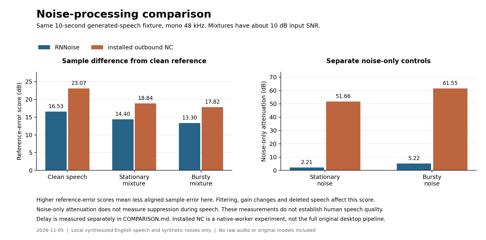

# Original versus openkrisp

Comparison checkpoint: November 5, 2026. Full parity is not established.
The independent microphone path transfers processed audio to a separate capture client. Zoom endpoint selection and packaged RNNoise Start/Stop pass. Real calls, human speech quality and many retained features still need work.

This report separates source implementation, observed execution and original behavior. The [feature ledger](feature-parity-ledger.md) remains the scope record. Its 22 retained, 6 unresolved and 4 excluded families are scope assignments, not completion percentages. Later runtime results belong in [CHECKPOINT.md](CHECKPOINT.md).

## What ran

The independent driver registered all four exact device UIDs. A real HAL test passed mono and stereo transfer, producer stop/restart, startup/stopped silence and the declared 960-frame route delay. Steady transfer had no mismatched samples. This is a 20 ms virtual-route contract at 48 kHz, not a measurement of the whole physical path.

The physical-microphone helper captured 395,264 samples, or 8.235 seconds, and produced raw and RNNoise-processed files from the same input. A separate run passed MacBook microphone → RNNoise → Lab Voice Microphone → FFmpeg AVFoundation capture. Both processes exited zero. The saved mono 48 kHz file contains 335,872 frames, or 6.997 seconds. The speaker leg was muted with zero gain. No audible-playback acceptance follows from these tests.

Zoom 7.1.9 initially omitted the endpoints. After the driver transport-property scope correction, Zoom displayed and selected both Lab Voice endpoints. CoreAudio reported Zoom input and output running on the exact microphone and speaker UIDs. The test restored the user's physical-device selections and did not join a meeting or activate audible test buttons. The packaged desktop also passed Start, external virtual-microphone capture, and Stop with independent RNNoise and speaker mute. The saved desktop capture contains 342,016 mono samples, or 7.125 seconds. These are the independent product's UI/runtime acceptance results, separate from original Krisp REA evidence. They do not establish speech quality or a remote call.

The same-input engine experiment below used local synthesized speech and files only. It did not use microphone capture, playback or a meeting. All generated audio and raw REA captures remain private and excluded from Git.

## Same-input noise processing

"Installed NC" below means the reviewed installed outbound model and native addon, called through our supervised worker under REA. It is not a capture of the complete original desktop application's processing graph. The app's own `original.wav` label means raw microphone samples, which is a different use of "original."

The fixture contains the complete synthesized sentence, "The local audio test keeps my voice clear while another sound plays in the room." The existing file-only macOS Samantha fixture has three seconds of leading silence, the whole utterance and trailing silence, for ten seconds total. Both engines received identical 480,000-sample mono Float32 inputs at 48 kHz. No resampling or level change occurred between engine inputs.

Controls were clean speech, stationary synthetic noise, synthetic bursts with tones, and each noise mixed with speech at approximately 10 dB active-speech input SNR. Each run began with fresh engine state. RNNoise used the production `StreamingNoise` adapter with callback blocks of at most 512 samples. Its known 480-sample buffering was removed by padding and trimming. Installed NC used the production broker and exact outbound role/hash admission, without a callback transport queue. No model algorithmic delay was removed before measurement.

Seven REA runs covered five installed-NC controls and two native bypass controls. Every run returned 480,000 finite samples, reported 1,000 processed frames and confirmed worker teardown. REA verified owned-process-group cleanup and temporary-root removal. Some captures retain unrelated platform-process attribution limits. All engine outputs had zero samples at or beyond full scale.

| Measurement on this fixture | Independent RNNoise v0.1.1 | Installed outbound NC |
| --- | ---: | ---: |
| Clean-control correlation lag | 480 samples / 10.00 ms | 1,280 samples / 26.67 ms |
| Clean-control fitted gain | 0.9920 | 0.9927 |
| Clean speech reference-error score | 16.53 dB | 23.07 dB |
| Stationary mixture reference-error score | 14.40 dB | 18.84 dB |
| Bursty mixture reference-error score | 13.30 dB | 17.82 dB |
| Stationary noise-only attenuation | 2.21 dB | 51.66 dB |
| Bursty noise-only attenuation | 5.22 dB | 61.55 dB |



Delay is the strongest clean-control cross-correlation within ±200 ms. Each engine's measured clean-control delay was held fixed for its noisy cases. These values exclude device, aggregate, callback-queue and meeting-client delays. They do not establish accepted call latency.

The reference-error score is `10 log10(clean energy / squared output error)` over the utterance window after that fixed alignment. Higher values mean less sample error in this fixture. Gain changes, filtering, phase changes, deleted speech and remaining noise all affect it. It is not a human intelligibility or opinion score. Noise-only attenuation uses seconds two through eight of separate noise-only runs and does not prove suppression during speech.

The installed native bypass control also had a 1,280-sample lag. Its clean aligned reference-error score was 23.35 dB, so bypass was not raw sample identity. This prevents attributing every original-path difference to noise suppression. The recovered pipeline and model can add processing beyond the requested on/off flag. The model-tail and full desktop bypass contracts remain unresolved.

These results show a material difference between the two engines on these inputs. They do not support an "equivalent to Krisp" quality claim. More speakers, quiet consonants, real noises, competing voices, blind listening and sustained routed tests are still required. No parity margin has been selected from these results.

## Retained feature comparison

"Partial" means that some source exists. It does not mean an accepted percentage of a feature. Historical fixture passes apply only to their recorded source and environment.

| Retained family | Source implementation | Observed runtime | Original comparison still required |
| --- | --- | --- | --- |
| Accent conversion | Separate identity-bound AR adapter and worker; outbound/inbound file inference passes | Original catalog declares target `us`; both installed models execute through the recovered AR contract | Live host/UI admission, human speech/accent quality, variants, headset rules and full desktop comparison |
| Live captions | Absent | None | Mac reachability, live input, result timing and local rendering |
| Installation, updates and repair | Development packaging and guarded driver procedures | Reviewed driver replacement/restart and four-UID discovery succeeded | Supported installer, repair, migration, update/rollback and uninstall workflows |
| Local storage | Import, search, export/delete, chosen library, retained-file recovery | Earlier native shell observations; current filesystem/controller fixtures | Native chooser/recovery paths, unavailable volumes, disk failure and original schema/lifecycle |
| Diagnostics | Private current-run report with explicit optional sample | Earlier native form observation; fixture coverage | Real pickers/errors, historical logs, taxonomy, attachments and original local report contract |
| Background voices | Exact installed candidate plus compatibility/override policy | Bounded native CPU evidence; no accepted live isolation | Original dispatch/defaults, headset matching and nearby-speaker preservation |
| Performance modes | No selectable Auto/CPU/Best policy | Short CPU probes only | Mode transitions, resource limits, default restore and sustained deadlines |
| Gain and mute | App-route linear gain/mute with acknowledgements | Muted/zero-gain speaker setting admitted in the live route | Measured control changes, original nonlinear virtual curve, hardware/HID sync and locking |
| Devices and routing | Independent HAL and private aggregate | Exact discovery, virtual HAL transfer, physical-to-FFmpeg route, Zoom endpoint selection and exact-UID process use pass | Real calls, simultaneous clients, unplug/Bluetooth, crash recovery and physical latency |
| Noise and echo cancellation | RNNoise; optional installed NC and AEC paths | Independent live mic route; bounded NC/AEC CPU experiments | Full original graph/order, acoustic echo reference, speech quality, tails and sustained timing |
| Temporary microphone comparison | Same-input raw/RNNoise pair, cancellation and explicit playback | Physical capture and paired-file creation passed | Native A/B modal/playback, permissions attribution, original test DSP and duration/admission behavior |
| Permissions | Explicit microphone and selected-file Speech admission | CLI capture and packaged desktop RNNoise Start/Stop with external capture pass | Permission deny/revoke paths, system-audio capture and recognition |
| Call activation | Stabilized process observations, blocking/switching policy | Synthetic controller/stream evidence and read-only inventory | Real app capture/ASR admission, competing calls, timing and source restoration |
| Transcription and speaker labels | Selected-WAV Apple offline adapter with timed segments | No accepted OS recognition or live original ASR | Real offline accuracy; live ASR, diarization, timestamp/result queues and transcript-only lifecycle |
| Recording and notes | Explicit route/selected-app recording, pause/save/recovery | Synthetic writer/controller evidence; separate raw test files do not prove this UI path | Actual saved-session workflow, original mix/order, failures, in-person/live notes and call switching |
| Participant consent reminders | Absent | None | Local templates, countdown/skip/cancel and setup errors without automatic external messages |
| Floating widget | Shared panel with route/recording state and stop/mute controls | Earlier limited native evidence; current feature acceptance incomplete | Call-triggered visibility, hide-for-now restoration, title/time, talk time and speaking assistance |
| Lifecycle | Login-item control, save-before-quit, power/lifecycle policy | Mostly injected tests; no accepted login/reboot/sleep/wake sequence | Native prompts, actual login, normal/forced exit, relaunch and device recovery |
| Notifications | Inline errors only | No full notification workflow | Event rules, warning preferences and call-start indicators |
| Common UI | Independent library/settings/dialogs, System/Light/Dark | Earlier bounded appearance/navigation observations | Current screen/interaction comparison and complete native error flows |
| Installed-model inference | Exact role/hash-bound NC workers and experimental AEC/BVC integration | Current outbound NC file experiments passed | Native provider selection, full live routes, dual-worker timing and all other local model types |
| Independent model providers | Fixed RNNoise inference and generic file/manifest validation | RNNoise physical route passed | Compatible alternative adapters, model switching and unsupported-feature behavior |

Six families remain unresolved at the original local/service boundary: agenda/calendar, screen capture, summary generation, connectivity/proxy behavior, Voice Translation and user-selected file processing/upload. A symbol or catalog label cannot establish local execution. The independent WAV import/transcription workflow does not settle the original upload contract.

Vendor account/trial/payment enforcement, cloud meeting bots/storage, external support services and product analytics/telemetry are excluded. Their exclusion does not prove completion of retained local behavior.

## Accent model execution

Current REA hashes bind the external inbound accent model `ar_inbound_wb_c_3.12.0_1.0.kef` to `73a59147ba88d0075e6a688f3cc641c5a46a6ffbb591c2f386b3affdb3e781df`, and outbound model `ar_outbound_wb_c_ma_3.11.0_1.0.kef` to `8ada1e4c3d2b3ef3c1440e39dfdfb825c7b0a4c0695c9e0ba6b06b576f124855`. Presence and hashing are not inference or redistribution permission.

A fresh static REA symbol search found `KMSStream::CreateARProcessor` at addon-relative address `0x0cad0c`, with distinct `AR::PerFrameConfigurationSupplier` and `AR::ResultHandlerWithStats<float>` types. This provides a concrete factory entry for the next investigation. Symbol names do not establish the field layouts, supported rates/frame counts, callback lifetime, per-frame updates, close/drain behavior or model/variant mapping. Accent models must not be inserted into the ordinary NC role map.

A follow-up exact-function capture recovered the AR wrapper's configuration writes: caller sampling rate at `+0x00`, owning model-path string at `+0x08`, zero model-data pointer/length at `+0x20/+0x28`, a threshold-enabled byte at `+0x30`, and the ringtone-detection threshold float at `+0x34`. The wrapper disables that threshold outside the accepted zero-to-one range. Its supplier also replaces return byte two with a KMS stream flag. The AR result path uses `FrameInfo` and can invoke a postprocessing chain. These observed differences require the separate AR adapter. The later investigation below completes the selected callable contract and runs both installed models.

The later [accent engine investigation](accent-engine-findings.md) recovers that separate contract and verifies both exact installed AR models through the C++ broker, sandboxed worker and native adapter. A ten-second Indian-English TTS fixture produces 999 output frames from 1,000 inputs, with one explicit empty startup reply, finite changed speech-scale output, no clipping and confirmed teardown. The original catalog explicitly declares `us` as the target. This establishes local model execution. Human accent quality, live route and desktop acceptance remain open. The dedicated findings contain the full evidence and limits.

## ElevenLabs speech sample

A second source uses a single authorized ElevenLabs request with a fixed, non-sensitive sales script. The saved account metadata identifies Raj - Professional Indian English, voice `wJ5MX7uuKXZwFqGdWM4N`, as English, Indian and conversational, with verified `en-IN` for `eleven_v4`. The request uses that model, stability 0.5, similarity 0.75 and mono MP3 at 44.1 kHz/128 kbps. The API returned 10.4 seconds and reported 195 characters of existing credit. No recording was uploaded, and no purchase or synthesis retry occurred. The API and metadata fields follow the [official speech endpoint](https://elevenlabs.io/docs/api-reference/text-to-speech/convert) and [voice metadata endpoint](https://elevenlabs.io/docs/api-reference/voices/search).

The complete speech was decoded to mono 48 kHz and padded with trailing silence to 15 seconds. The frozen AR adapter and exact outbound model returned 1,499 frames from 1,500 input frames, with one explicit empty startup reply. Output RMS is 0.07703, absolute peak is 0.74514 and no sample reaches full scale. Broker readiness took 310 ms and processing took 1,476 ms. REA `ev_7701dc33ee8b66f6375caf44c86543af42af0fb7887fb2ddff94b8e2a0b03220` confirms exit 0 and native teardown. Owned process-group cleanup is verified and its temporary root is removed; one unrelated platform-process attribution limit remains.

The private original and converted WAVs are available for listening. The source voice's labels and nonidentity converted waveform do not establish accent quality. No blind listening or real call was performed. No speech time stretch, gain normalization or delay trimming was applied. The padding is an explicit test policy, not a recovered SDK drain. Full settings, hashes and timing are in the private `../evidence/model-probes/elevenlabs-accent-20261105/comparison-metrics.json`, SHA256 `cc27d2af779a0c3b15d5b24f8d81a49ed6a7a68ba827875c95d213eea41702cd`.

## Evidence and reproduction limits

The reference is the recorded Krisp 3.17.9 installation. Its current ASAR hash is `40269da405babcd79c18780715c63625d0bb7035f03a480b1732fe067ba911b4`; the native addon is `adde50ff549700fd535fb9cc8e42d45fa36dca02131009ded727a10625ae8755`. The installed outbound model admission remains `12110c114a3c6c4e2a00c26b22d06463239d096da9f7b71a948fd3a7005b355d`. No reference binary or model is included here.

The private experiment directory is `../evidence/model-probes/nc-speech-comparison-20261105/`. It retains the fixture metadata, exact inputs/outputs, two bounded own probe sources/executables, the metric script, scenarios and complete REA results. The NC measurement probe is an own derivative of `installed_worker_probe.cpp` with the fixed experiment length increased from 100 to 1,000 frames. Production worker admission, frame exchange and close logic are unchanged. RNNoise calls the production streaming adapter. The metric script passed a known 37-sample delay and 0.5-gain check. NumPy 2.4.4 was used for this private analysis; it is not a product dependency.

| Observation | REA Evidence ID |
| --- | --- |
| Clean speech, installed NC | `ev_bcbff9c68b78cff88ac89c7ae8fc2f8d5ba3455acdff5f2240e9e19e28dfb924` |
| Stationary noise only | `ev_85d31baccb8d4dcf4a36f22600e37e73910f67616273118c94646026f0484990` |
| Bursty noise only | `ev_402c369451ed3ca5fffd6c2cb7125a8a9fc5f0935216fd2c0ed35dad2801e625` |
| Stationary mixture | `ev_46553ff5f1244d1ba1a8700ad41555c96197a3ef6b56fc00740756395885139b` |
| Bursty mixture | `ev_f28a65fe3e40f6e9a405d2fab668021614284ad9e5e1b5e3fcf74c49b4ca46c3` |
| Clean native bypass | `ev_d374ebdb3db53470b30a92218f8d16e8c49f7b62beb6e89d1875d8f539eb7143` |
| Stationary-mixture native bypass | `ev_f7a00a29776dc89c98b284fb4e15ec61974c8f881b6f06c7b245111132ef7b58` |
| Static AR factory, supplier and handler bodies | `ev_2d4db8f8b1d0d5488f69c2984337698a45b3ff58bc3cde03f90c934aee03a069` |
| Static accent factory names | `ev_1fe86bb7b8de8804f8d0555d330171bfc098a9c6a8381e554fc9b7fe3d2860eb` |

Each original worker used the reviewed deny-network launch and checked exact Node, addon, model and adapter identities. Hashes are prelaunch/read samples, not atomic loaded-image binding. REA process sampling can omit short-lived descendants; network traffic is not independently observed by the process capture. The recorded sandbox and the worker's denied-loopback prerequisite are separate controls.

To recreate the plot from an explicitly supplied metrics file, run:

```sh
python3 verification/plot_noise_comparison.py /absolute/path/to/metrics.json /new/output.png
```

Matplotlib is required for that optional plotting command. It does not load an audio file, execute a provider or fetch any reference artifact.

The local C++ component suites and the production desktop build/resource/signature checks passed at this checkpoint. Root `./verify` stopped because the installed Command Line Tools lack XCTest. The Swift test suites therefore have no new full pass here. Prior passes remain historical evidence, and packaging success does not replace tests.

The later independent product acceptance records are `../evidence/zoom-and-route-acceptance-20261105.json`, SHA256 `4eac667c8cba6ec523d27f6b7d6f045d0da6b69e2ccbcefada672824d7f5fe40`, and `../evidence/native-desktop-acceptance-20261105.json`, SHA256 `fe73e30131056f4860fa5dc3ad59fa4e2f2a016ad715f84422f93ec4786bb42b`. They cover Zoom endpoint selection and packaged RNNoise Start/Stop with external capture. They are own-product records, not original-artifact REA captures.
